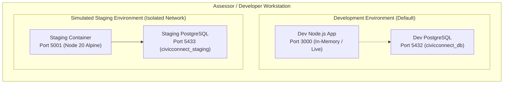

# CivicConnect: Staging Deployment & Rollback Operational Guide
## Controlled Release Candidate Verification & Disaster Recovery Strategy

**Academic Year:** 2026  
**Module:** Software Engineering 381 (SEN381) — NQF Level 8  
**Project:** CivicConnect (Community Service Request Management Platform)  
**Governing Standard:** SEN381 Milestone 3 Brief §14 & §15  
**Document Identifier:** `DOC-GUIDE-STAGE-001`  
**Governing ADRs:** `ADR-008` (Tech Stack), `ADR-011` (Staging Parity & Rollback Strategy)  
**Author:** Chris Fourie (602826) — Systems Architect & Governance Lead  

---

## 1. Staging Environment Architecture & Isolation Model

In strict compliance with **SEN381 Milestone 3 Brief §14**, CivicConnect provides a demonstrable simulated staging environment isolated from local development.



### 1.1 Environment Parity Matrix

| Configuration Dimension | Local Development | Simulated Staging Environment | Production Standard (Future) |
| :--- | :--- | :--- | :--- |
| **Application Runtime** | Node.js 20 LTS (Host/TSX) | Node.js 20 Alpine (`Dockerfile`) | OCI Linux Container on Cloud PaaS |
| **Application Port** | `3000` | `5001` (Isolated port) | `80` / `443` (TLS terminated) |
| **Database Engine** | In-Memory Harness / Postgres 16 | PostgreSQL 16 Alpine (`docker-compose.staging.yml`) | Managed PostgreSQL (Neon / Supabase) |
| **Database Port** | `5432` | `5433` (Isolated port) | `5432` (Private VPC) |
| **Release Identifier** | `development-dev` | `v0.3.0-rc1` (Injected via env) | `v0.3.0` Immutable tag |
| **Database Name** | `civicconnect_db` | `civicconnect_staging` | `civicconnect_prod` |
| **Secrets Management** | `.env` / In-Memory Defaults | `.env.staging` (Uncommitted secrets) | Cloud Secret Manager / KMS |

---

## 2. Staging Deployment Execution Sequence

### Step 1: Provision Isolated Staging Configuration
Ensure `.env.staging` is created from the template:
```bash
cp code/.env.staging.example code/.env.staging
```

### Step 2: Build and Launch Staging Containers
From the `code/` directory, launch the isolated multi-stage containers:
```bash
docker compose -f docker-compose.staging.yml up --build -d
```

### Step 3: Verify Release Candidate Identification & Health
Execute health probes against the staging port (`5001`):
```bash
# 1. Liveness probe & Release Candidate Metadata
curl http://localhost:5001/health/live

# Expected Response:
# {
#   "status": "UP",
#   "version": "v0.3.0-rc1",
#   "commit": "v0.3.0-rc1-baseline",
#   "uptimeSeconds": 14,
#   "memoryUsageMB": 42
# }

# 2. Database Connectivity & Readiness Probe
curl http://localhost:5001/health/ready

# Expected Response:
# {
#   "status": "READY",
#   "database": "CONNECTED",
#   "timestamp": "2026-10-03T..."
# }
```

### Step 4: Run E2E Smoke Verification Against Staging
Verify interactive UI portal accessibility by navigating to:
```text
http://localhost:5001/
```

---

## 3. Rollback & Disaster Recovery Protocol

Per M3 Brief §14 (*"Prepare a simple rollback/recovery approach: what version/artefact would you restore and what data/configuration concern must be considered?"*):

### 3.1 Scenario A: Application Release Candidate Regression (Rollback Code Only)
If release candidate `v0.3.0-rc1` introduces an unexpected runtime defect:
1. Revert container image to the verified Milestone 2 baseline commit (`ffc17cb`):
   ```bash
   git checkout ffc17cb
   docker compose -f docker-compose.staging.yml up --build -d
   ```
2. Because M3 database schema additions are backward-compatible (`Expand-Contract Pattern`), M2 application code continues operating without data corruption.

### 3.2 Scenario B: Corrupted Database Schema (Full DDL Rollback)
If database migrations fail during staging initialization:
1. Apply the declarative reverse migration script:
   ```bash
   docker exec -i civicconnect-staging-db psql -U staging_admin -d civicconnect_staging < code/database/migrations/V1__rollback_initial_schema.sql
   ```
2. Re-apply the baseline schema and seed records:
   ```bash
   docker exec -i civicconnect-staging-db psql -U staging_admin -d civicconnect_staging < code/database/migrations/V1__initial_schema.sql
   docker exec -i civicconnect-staging-db psql -U staging_admin -d civicconnect_staging < code/database/seeds/01_baseline_seeds.sql
   ```
3. Restart staging application container to restore pool connectivity.

### 3.3 Data & Operational Considerations During Rollback
* **Residual Data Loss:** Reverting database tables drops any staging test tickets created after migration.
* **Transient Session Disruption:** Active HTTP requests during container rebuild return `502 Bad Gateway` until the 15-second healthcheck completes.

---

## 4. Production Differences & Honest Limitations

* **Single-Node Execution:** Staging runs on a single host workstation; it does not replicate multi-zone availability or Kubernetes ingress routing.
* **Mock Notification Gateway:** SMS/Email dispatchers operate in-memory rather than invoking external Twilio/SendGrid REST endpoints.
* **Volume Persistence:** Staging uses Docker local volumes; production requires managed PostgreSQL automated daily snapshots and write-ahead log (WAL) archiving.
